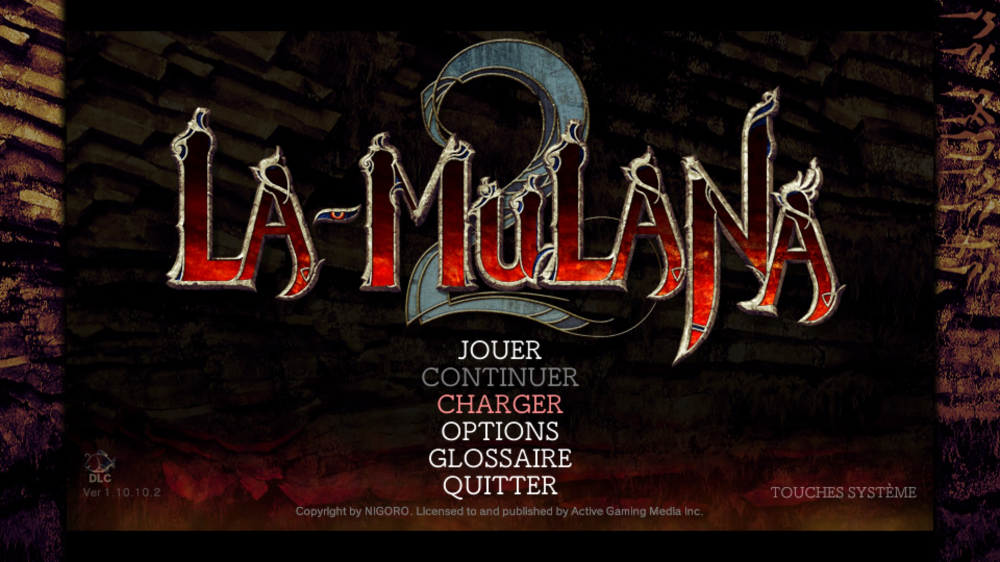
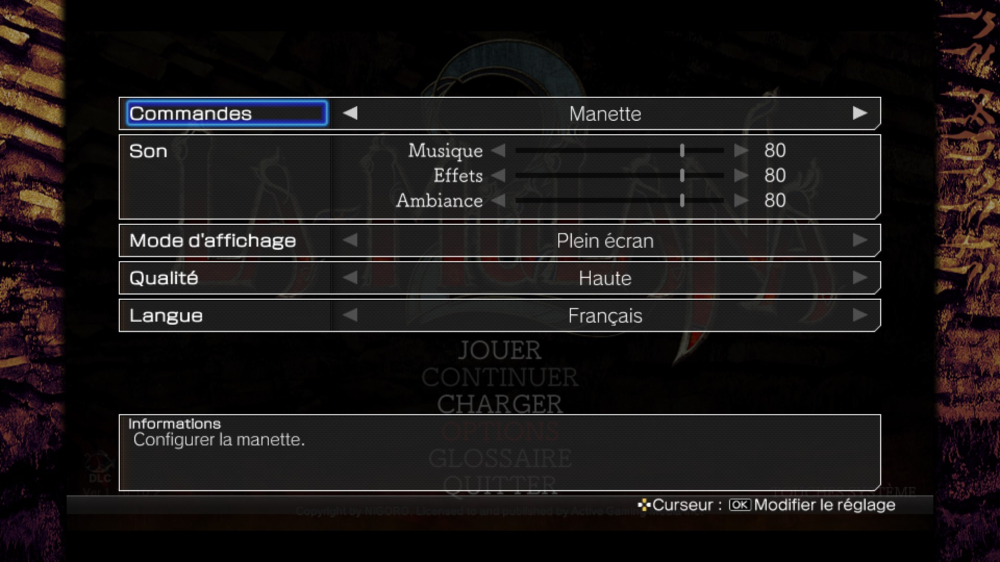
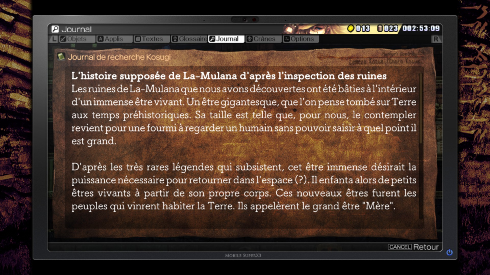

# La-Mulana 2 — Traduction française

<p align="center">
  
  
  
</p>

Patch non officiel qui ajoute le **français** à La-Mulana 2 (version Steam). Le jeu n'existe officiellement qu'en anglais, japonais et chinois.

- Le français **remplace le chinois** : l'anglais et le japonais restent disponibles, et on peut changer de langue en jeu pour comparer.
- **Aucun fichier du jeu n'est modifié** : le patch remplace les textes en mémoire au lancement, via [BepInEx 5](https://github.com/BepInEx/BepInEx). Il s'installe et se retire en copiant ou supprimant quelques fichiers.
- Il faut posséder le jeu original.

> **Version de test.** La traduction est complète mais n'a pas encore été jouée d'un bout à l'autre. Vos retours sont précieux, surtout sur les énigmes.

## Installation

Téléchargez la dernière archive `LaMulana2FR-x.y.z.zip` depuis la page **Releases**.

### Windows

1. Dans Steam : clic droit sur La-Mulana 2 → **Gérer** → **Parcourir les fichiers locaux**.
2. Décompressez le contenu de l'archive dans ce dossier. Vous devez voir, à côté de `LaMulana2.exe`, le dossier `BepInEx`, `winhttp.dll` et `doorstop_config.ini`.
3. Lancez le jeu, ouvrez les options (**SETTINGS → Language**) et choisissez **Français**.

### Linux et Steam Deck (Proton)

1. Dans Steam : **Propriétés** du jeu → **Compatibilité** → forcez l'utilisation de Proton.
2. Décompressez le contenu de l'archive dans le dossier du jeu, comme sous Windows.
3. **Propriétés → Général → Options de lancement**, ajoutez :

   ```bash
   WINEDLLOVERRIDES="winhttp=n,b" %command%
   ```

4. Lancez le jeu et choisissez **Français** dans les options.

Sans l'option de lancement, Proton ignore BepInEx et le jeu démarre sans le patch.

### Vous avez déjà BepInEx 5

Prenez l'archive `-plugin` et copiez le dossier `LaMulana2FR` dans `BepInEx/plugins`.

### Vérifier que le patch est chargé

Après un lancement, `BepInEx/LogOutput.log` doit contenir une ligne du type :

```
[Info   :La-Mulana 2 FR] 4212 textes remplacés, 0 lignes ignorées.
```

### Désinstallation

Repassez d'abord la langue en anglais, puis supprimez du dossier du jeu : le dossier `BepInEx`, `winhttp.dll` et `doorstop_config.ini`.

## État de la traduction

| Contenu | État |
|---|---|
| Menus, options, messages système | Traduit |
| Objets, armes, tenues, applis (descriptions) | Traduit |
| Noms de zones et de salles | Traduit |
| Stèles, panneaux, fresques | Traduit |
| Dialogues, boutiques, messages Xelputter | Traduit |
| Bestiaire et fiches de personnages | Traduit |
| DLC (Tour d'Oannès) | Traduit |
| Titres de musiques, noms de touches, crédits | Laissés en anglais |
| Textes dessinés dans les images | Non traités |

3 970 lignes sur 4 209 sont en français.

### Limites connues

- Les polices du jeu n'ont ni `œ` ni `« »` : ils sont rendus par `oe` et des guillemets droits.
- Sur un système en français, le jeu démarre en anglais : il faut choisir « Français » une fois dans les options.
- Certains textes peuvent déborder de leur cadre (le français est plus long que l'anglais).
- Les noms des applis et logiciels du jeu sont volontairement laissés en anglais.

## Parti pris de traduction

La-Mulana 2 repose sur des énigmes dont les indices sont dispersés dans les stèles et les dialogues. La traduction a été faite avec trois règles :

1. **Un terme, un mot.** Les mots-clés que le jeu met en couleur (objets, lieux, peuples, gardiens) ont une seule traduction, fixée dans [`traduction/glossaire_propositions.txt`](traduction/glossaire_propositions.txt).
2. **Les mots des mantras sont intouchables.** Les dix mantras et leurs deux sens (Cieux/Toit, Terre/Route, Soleil/Éternité, Lune/Manque, Mer/Mur, Feu/Tremblement, Vent/Cri, Mère/Vœu, Enfant/Hurlement, Nuit/Fin) sont repris à l'identique partout où une énigme y fait allusion.
3. **Le japonais comme arbitre.** Le texte de départ est l'anglais, mais chaque indice a été comparé à l'original japonais, et recoupé avec une soluce pour vérifier que le français mène à la même solution, sans en dire plus. Quelques contresens de la version anglaise ont été corrigés à cette occasion.

## Signaler un problème

Ouvrez un ticket (**Issues**) en précisant :

- la zone et, si possible, la salle ;
- une capture d'écran ;
- pour une énigme : ce que l'indice français vous a fait comprendre, et ce qu'était la solution.

Les fautes, les débordements de texte et les indices trompeurs sont tous bons à signaler.

## Contribuer à la traduction

Les textes français sont dans [`traduction/lots/`](traduction/lots/), un fichier par base de textes du jeu, au format :

```
### nom_de_la_feuille
12: Texte français de la ligne 12 (\n pour un retour à la ligne)
```

Les balises `<color=#…>…</color>` et `<sprite name=…>` doivent être conservées telles quelles.

Les textes originaux du jeu ne sont pas dans ce dépôt : ils sont extraits de votre propre installation.

### Mettre en place l'environnement

Il faut Windows, [PowerShell 7](https://github.com/PowerShell/PowerShell), le SDK .NET (pour compiler le plugin) et le jeu avec BepInEx 5 installé.

1. Si le jeu n'est pas dans l'emplacement Steam par défaut, créez à la racine du dépôt un fichier `chemin_jeu.txt` contenant le chemin du dossier du jeu.
2. Extrayez les textes du jeu et appliquez-y la traduction :

   ```bash
   pwsh -NoProfile -File outils/preparer.ps1
   ```

3. Après avoir modifié un lot, reportez-le et reconstruisez le patch :

   ```bash
   pwsh -NoProfile -File outils/importer_lot.ps1 -Base L2WordDataBase
   ```

   ```bash
   pwsh -NoProfile -File outils/construire_patch.ps1
   ```

`importer_lot.ps1` signale toute ligne dont les balises ne correspondent plus à l'original. `construire_patch.ps1` génère `fr.txt`, compile le plugin et l'installe dans le jeu (ajoutez `-SansInstallation` si le jeu est ouvert).

### Organisation du dépôt

| Dossier | Contenu |
|---|---|
| `plugin/` | Source du plugin BepInEx (C#) |
| `outils/` | Scripts d'extraction, d'import, de construction et de release |
| `traduction/lots/` | La traduction française |
| `traduction/glossaire_propositions.txt` | Le glossaire des termes |

## Crédits et mentions

- La-Mulana 2 est une œuvre de **NIGORO**, éditée par **PLAYISM**. Ce patch est un travail de fans, sans lien avec eux.
- Le patch s'appuie sur [BepInEx](https://github.com/BepInEx/BepInEx) (licence LGPL-2.1), inclus dans l'archive complète.
- Les indices ont été recoupés avec le guide Steam *Viceroy's Hint-Based Guide to Eg-Lana*.
